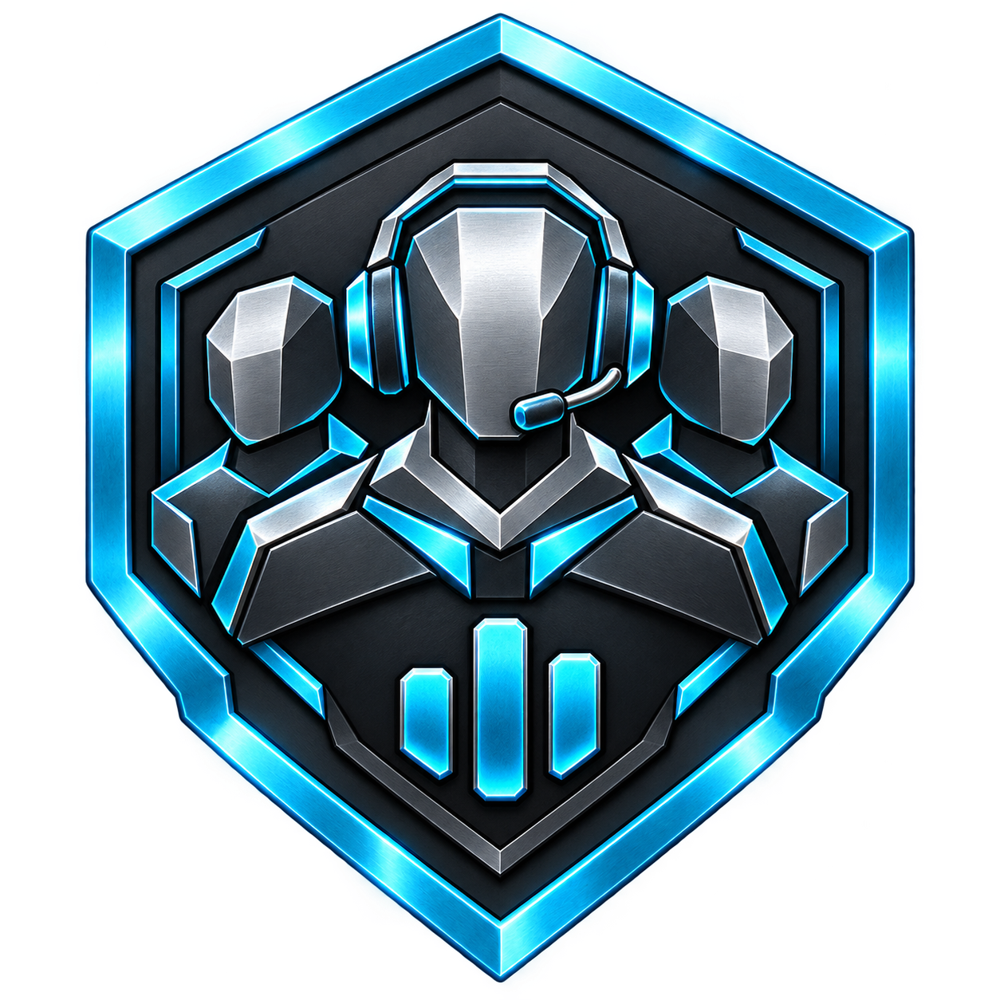
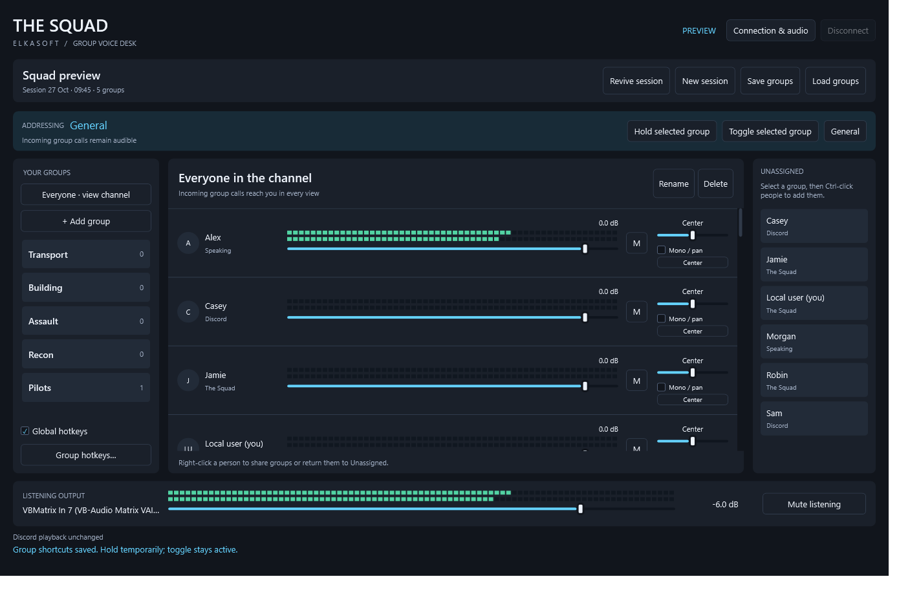

# The Squad · ElkaSoft

The Squad is a Windows group voice mixer for Discord. One central Discord bot listens to the voice channel and relays each person's voice to The Squad separately. You choose who you hear by group (Transport, Building, Assault, Recon, Pilots, or your own). Each person gets their own volume, mute, meters and pan.

Your microphone stays in Discord. The Squad only handles listening and group routing.

This public repository contains documentation and downloadable release packages. It intentionally does not contain The Squad's source code.

## Download

**Latest:** [Preview 7](https://github.com/torment78/Elka.TheSquad-Releases/releases/tag/v0.2.0-preview.7). Get the installer there.

Open **Releases** and pick the latest pre-release.

**To join a squad (most people):** you only need the desktop app.

- `ELKA.TheSquad-<version>-setup-win-x64.exe`: the recommended installer.
- `ELKA.TheSquad-<version>-win-x64.zip`: portable alternative. Extract it and run `ELKA.TheSquad.App.exe`.

Both are for Windows 11 x64 and include the .NET runtime. Previews are **unsigned**, so Windows SmartScreen may warn before the first run.

**To host your own server (not ready yet):** `ELKA.TheSquad-<version>-server-source.zip` is a separate download. It is the Docker server that runs the Discord bot. It isn't ready for general use yet; it needs your own Discord application, bot token and an HTTPS address. Skip it if you are joining someone else's squad.

`ELKA.TheSquad-<version>-SHA256SUMS.txt` lists checksums for every download.

## Start here

1. Install The Squad and open it. The first screen is a silent preview.
2. Open **Settings → Connection**, enter the server address your squad leader gives you, and choose **Sign in / connect**.
3. Finish Discord sign-in in the browser that opens. When the browser says sign-in is complete, the app finishes on its own.
4. Join the bot's voice channel in Discord, then choose **Sign in / connect** again if needed.
5. Pick where you listen in **Settings → Audio**.

Only start sign-in from your own copy of The Squad, and never use a sign-in link someone sends you.

## Good to know

- Click a group to hear only its members. **Everyone · view channel** returns to hearing the whole channel.
- Volume faders run from silence to +18 dB for quiet microphones. The fill turns yellow, orange, then red as you boost.
- **Settings → Audio → Listening cushion** (default 50 ms) smooths stutters on slower connections at the cost of a little delay.
- People listening in normal Discord still hear your microphone. Group routing applies only inside The Squad.
- The desktop and server must be the same preview. An update message appears at sign-in if they differ.
